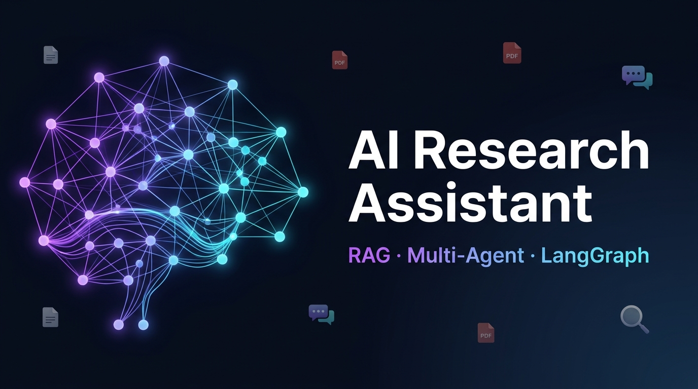

<div align="center">



<br/>

# 🔬 AI Research Assistant

### *Upload research papers. Ask anything. Get rigorous, cited, hallucination-free answers.*

<br/>

[](https://python.org)
[](https://fastapi.tiangolo.com)
[](https://langchain-ai.github.io/langgraph/)
[](https://streamlit.io)
[](https://www.trychroma.com)
[](https://ai.google.dev)
[](LICENSE)

<br/>

[**🚀 Quick Start**](#-quick-start) · [**🏗️ Architecture**](#-architecture) · [**🤖 Agent Pipeline**](#-agent-pipeline) · [**📡 API Reference**](#-api-reference) · [**🗺️ Roadmap**](#-roadmap)

</div>

---

## ✨ What is this?

**AI Research Assistant** is a production-grade Retrieval-Augmented Generation (RAG) system that lets you have deep, intelligent conversations with your own collection of research papers (PDFs). Powered by a **5-agent LangGraph pipeline**, it doesn't just retrieve — it *synthesizes*, *fact-checks*, and *suggests next questions*, all grounded in your documents.

> **Perfect for:** Researchers, students, academics, and engineers who regularly read technical papers and want a smart AI companion to query their knowledge base.

<br/>

## 🎯 Key Features

| Feature | Description |
|:--------|:------------|
| 📄 **PDF Ingestion** | Upload any research paper — automatically parsed, chunked, and vectorized |
| 🔍 **Semantic Retrieval** | ChromaDB-powered vector search finds the most relevant passages instantly |
| 🌐 **Web Search Fallback** | When local context is insufficient, Tavily fills in the gaps from the web |
| 🧠 **Synthesis Agent** | Composes a comprehensive, structured answer with inline citations |
| ✅ **Fact-Checking Agent** | Rigorously cross-references claims against source text — **zero hallucinations** |
| 💡 **Follow-up Generator** | Suggests 3 intelligent research questions to deepen your exploration |
| 🔄 **Real-time Transparency** | See every agent's work — retrieved chunks, web results, and reasoning — in the UI |

<br/>

## 🏗️ Architecture

```
┌─────────────────────────────────────────────────────────────────────┐
│                        AI Research Assistant                         │
├──────────────────┬──────────────────────────────────────────────────┤
│   FRONTEND       │                   BACKEND                         │
│  (Streamlit)     │               (FastAPI + LangGraph)               │
│                  │                                                    │
│  ┌────────────┐  │  POST /upload      ┌─────────────────────────┐   │
│  │ PDF Upload │──┼──────────────────► │   RAG Manager           │   │
│  └────────────┘  │                    │  PyPDF → Chunking →     │   │
│                  │                    │  Embeddings → ChromaDB  │   │
│  ┌────────────┐  │  POST /query       └─────────────────────────┘   │
│  │ Chat UI    │──┼──────────────────►                               │
│  └────────────┘  │                    ┌─────────────────────────┐   │
│                  │                    │   LangGraph Pipeline    │   │
│  ┌────────────┐  │  ◄─────────────────│                         │   │
│  │ Agent      │  │  JSON Response     │  ① Retrieval Agent      │   │
│  │ Details    │  │  {answer,          │  ② Web Search Agent     │   │
│  │ Expander   │  │   sources,         │  ③ Synthesis Agent      │   │
│  └────────────┘  │   follow_ups}      │  ④ Fact-Check Agent     │   │
│                  │                    │  ⑤ Follow-up Agent      │   │
│                  │                    └─────────────────────────┘   │
└──────────────────┴──────────────────────────────────────────────────┘
```

<br/>

## 🤖 Agent Pipeline

The heart of this system is a **stateful LangGraph workflow** that chains 5 specialized agents:

```
User Query
    │
    ▼
┌──────────────────┐
│ ① Retrieval Agent│  Queries ChromaDB for relevant paper chunks
│                  │  → Determines if web search is needed
└────────┬─────────┘
         │
         ▼
┌──────────────────┐
│ ② Web Search     │  Calls Tavily Search API if local corpus
│    Fallback Agent│  is insufficient (score threshold: 0.8)
└────────┬─────────┘
         │
         ▼
┌──────────────────┐
│ ③ Synthesis Agent│  Gemini 1.5 Pro synthesizes a structured,
│                  │  cited answer from all retrieved context
└────────┬─────────┘
         │
         ▼
┌──────────────────┐
│ ④ Fact-Checking  │  Rigorously audits every claim against
│    Agent         │  source excerpts. Corrects or caveats any
│                  │  unsupported statements.
└────────┬─────────┘
         │
         ▼
┌──────────────────┐
│ ⑤ Follow-up      │  Generates 3 intelligent research questions
│    Generator     │  to guide the next step of exploration
└────────┬─────────┘
         │
         ▼
   Final Response
 {answer + sources + follow_ups}
```

<br/>

## 🛠️ Tech Stack

<div align="center">

| Layer | Technology | Purpose |
|:------|:-----------|:--------|
| **LLM** | Google Gemini 1.5 Pro | Synthesis, fact-checking, follow-up generation |
| **Orchestration** | LangGraph | Stateful multi-agent workflow |
| **RAG Framework** | LangChain | Document loading, text splitting, embedding |
| **Vector Store** | ChromaDB | Persistent semantic document storage |
| **Web Search** | Tavily Search API | Real-time web fallback |
| **Backend API** | FastAPI + Uvicorn | High-performance REST API |
| **Frontend** | Streamlit | Interactive chat UI |
| **PDF Parsing** | PyPDF | Document ingestion |

</div>

<br/>

## 🚀 Quick Start

### Prerequisites

- Python 3.10+
- A [Google AI Studio](https://aistudio.google.com) API key (for Gemini)
- A [Tavily](https://tavily.com) API key (free tier available)

### 1. Clone the Repository

```bash
git clone https://github.com/Idhant-Mehta/ai-research-assistant.git
cd ai-research-assistant
```

### 2. Configure Environment

Create a `.env` file inside `backend/`:

```env
GEMINI_API_KEY=your-gemini-api-key-here
TAVILY_API_KEY=your-tavily-api-key-here
```

> 💡 **Get your keys:**
> - Gemini: [aistudio.google.com/app/apikey](https://aistudio.google.com/app/apikey) (free)
> - Tavily: [app.tavily.com](https://app.tavily.com) (free tier: 1000 requests/month)

### 3. Install Dependencies & Run Backend

```bash
cd backend
pip install -r requirements.txt
uvicorn app.main:app --reload --port 8000
```

The API will be live at `http://localhost:8000` · API docs at `http://localhost:8000/docs`

### 4. Run Frontend

Open a new terminal:

```bash
cd frontend
pip install streamlit requests
streamlit run app.py
```

Open your browser to `http://localhost:8501` 🎉

<br/>

## 📡 API Reference

### `POST /upload`

Upload and ingest a PDF research paper.

```bash
curl -X POST "http://localhost:8000/upload" \
  -H "accept: application/json" \
  -F "file=@your_paper.pdf"
```

**Response:**
```json
{
  "filename": "attention_is_all_you_need.pdf",
  "chunks_ingested": 42,
  "message": "Successfully ingested"
}
```

---

### `POST /query`

Query the multi-agent pipeline with a research question.

```bash
curl -X POST "http://localhost:8000/query" \
  -H "Content-Type: application/json" \
  -d '{"query": "What attention mechanism does the Transformer use?"}'
```

**Response:**
```json
{
  "final_answer": "The Transformer uses a multi-head self-attention mechanism...",
  "retrieved_docs": [...],
  "web_search_results": "...",
  "fact_check_result": "Passed",
  "follow_ups": [
    "1. How does multi-head attention differ from single-head?",
    "2. What are the computational complexity trade-offs?",
    "3. How has attention been adapted for vision tasks?"
  ]
}
```

<br/>

## 📁 Project Structure

```
ai-research-assistant/
├── 📁 backend/
│   ├── 📁 app/
│   │   ├── 🐍 main.py          # FastAPI application & endpoints
│   │   ├── 🤖 agents.py        # LangGraph multi-agent workflow
│   │   └── 🔍 rag.py           # RAG manager (embedding + ChromaDB)
│   ├── 📁 tests/               # Pytest test suite
│   ├── 📁 uploaded_pdfs/       # PDF storage (git-ignored)
│   └── 📋 requirements.txt     # Python dependencies
├── 📁 frontend/
│   └── 🎨 app.py              # Streamlit chat interface
├── 📁 assets/
│   └── 🖼️  banner.jpg          # Repository banner
├── 🚫 .gitignore
└── 📖 README.md
```

<br/>

## 🗺️ Roadmap

- [x] Core RAG pipeline with ChromaDB
- [x] 5-agent LangGraph orchestration
- [x] Web search fallback with Tavily
- [x] Fact-checking agent to prevent hallucinations
- [x] Streamlit chat UI with agent transparency
- [ ] 🔜 Multi-document conversation memory
- [ ] 🔜 Citation highlighting in PDF viewer
- [ ] 🔜 Docker Compose deployment
- [ ] 🔜 Support for additional document formats (DOCX, HTML)
- [ ] 🔜 User authentication & personal document libraries
- [ ] 🔜 Evaluation dashboard with RAGAS metrics

<br/>

## 🤝 Contributing

Contributions are welcome! Please feel free to open an issue or submit a pull request.

1. Fork the repo
2. Create your feature branch: `git checkout -b feature/amazing-feature`
3. Commit your changes: `git commit -m 'Add some amazing feature'`
4. Push to the branch: `git push origin feature/amazing-feature`
5. Open a Pull Request

<br/>

## 📄 License

This project is licensed under the **MIT License** — see the [LICENSE](LICENSE) file for details.

<br/>

## 🙏 Acknowledgements

- [LangChain](https://langchain.com) & [LangGraph](https://langchain-ai.github.io/langgraph/) for the agentic orchestration framework
- [Google Gemini](https://ai.google.dev) for the powerful language model
- [ChromaDB](https://www.trychroma.com) for the vector store
- [Tavily](https://tavily.com) for real-time web search

---

<div align="center">

Made with ❤️ and a lot of research papers

⭐ **Star this repo if you find it useful!** ⭐

</div>
